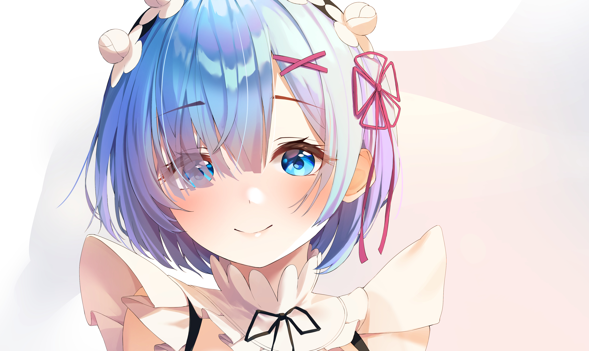

<figure>

<figcaption>Is it her? Oh yeah, it really is, her.</figcaption>

</figure>

I recently found out that Rem from **Re:Zero - Starting Life in Another World**, had finally woken up from her coma, in the anime. The incessant **"Who's Rem?"** jokes from the other anime fandoms will hopefully cease, right?

<label class="spoiler"><input type="checkbox" class="spoiler-toggle" autocomplete="off">
Nope! It is ruined in typical Tappei fashion, as Rem awakens without her memories. Why must Tappei-sensei make the fandom suffer for so long?
</label>

Wait a minute! Let me give you some context before I reminisce...

I was 21 when I discovered Re:Zero and it profoundly changed my outlook on life and it is by far, my favorite anime of all time (Assassination Classroom comes close). The anime is not your typical isekai where the unremarkable main character gets killed by [Truck kun](https://en.wikipedia.org/wiki/Truck-kun) & is transported to a fantasy world where they magically become capable and is bestowed with fame, glory and fortune.

Instead, **Subaru Natsuki** is a guy with an inferiority complex, borne out of not being able to get out of his dad's shadow. One fine day, he is magically transported to a kingdom called Lugnica, with a horrifying ability to resurrect after death to a seemingly random checkpoint in the past, while everyone else doesn't remember what happened in the previous loop. A mysterious Witch makes sure that Subaru doesn't reveal it to anyone.

Awesome! We've found a Japanese Charlie Kaufman who gave [Eternal Sunshine of the Spotless Mind](https://www.primevideo.com/detail/0LPGS3GJSYAHK8Y0J7AVQ9V10O) a brutal, video game twist. Themes of memory, loss and interesting blue-haired women in the middle of them, huh? That's my type, I guess.

Subaru meets **Emilia**, who's competing for the throne of Lugnica. Smitten by her, he dies multiple times while trying to help Emilia and eventually succeeds. As a token of gratitude, Emilia takes Subaru to the mansion of Roswaal L Mathers, her political sponsor.

**Enter Rem and Ram**, who work as maids in Roswaal's mansion.

They are demon twins, born with one horn each instead of two horns. The villagers decide to kill the twins before Ram displays god-like powers to save herself and Rem. Rem grows up in Ram's shadow and develops an inferiority complex because her sister is a prodigy, which makes her feel worthless and unwanted.

A witch cult decimates the village and Ram loses her horn to save Rem. As a result, Rem is fiercely protective of her sister.

Rem is polite but distant towards strangers and is incredibly suspicious of Subaru because he mysteriously emanates the smell of the same Witch whose cult decimated her community.

For the first few loops in the mansion, Rem brutally murders & tortures Subaru. Subaru acquaints himself with the twins on subsequent retries and eventually risks his life to save Rem. Rem is deeply guilt-ridden for suspecting Subaru of malice and admits that she hesitated to help him because of the Witch's scent on him. She, in turn, saves him with Roswaal's help.

Back at the mansion, Rem opens up about her insecurities while tending to Subaru's injuries. Subaru comforts her and says that she's worth cherishing, independently of Ram and she has her own strengths and it's better that they look forward to the future, rather than beat themselves up over the past.

Upon hearing this, she falls in love with Subaru.

Due to his intense obsession with Emilia, Subaru embarrasses both himself and Emilia in the royal selection, which causes Emilia to distance herself from Subaru. Subaru subsequently learns that the witch cult plans to invade Roswaal's territory and fails to stop it multiple times. Rem sacrifices herself and confesses her love to Subaru in one of the loops.

Subaru is mentally destroyed by the multiple failed attempts to save everyone. His trauma becomes unbearable when he tries to reveal his ability to Emilia and gets her accidentally killed.

# [UNHOLY CONFESSIONS]

Feeling hopeless and helpless, Subaru decides to abandon everyone and asks Rem to elope with him. He does this because he feels unable to save everyone and tries to use Rem to escape his predicament.

Rem senses that something's wrong with Subaru and rejects his proposal. She proceeds to do something so unexpected that I was kinda shook when I watched it.

She confesses that she desperately wants the future he wants but not when Subaru is broken down and has given up on people and sees her as a means for escapism. She then describes her imagined life with Subaru in great detail, from a home to jobs to owning a small shop to marriage to kids. She says that her ideal death is passing away before Subaru, surrounded by her children and grandchildren.

<label class="spoiler"><input type="checkbox" class="spoiler-toggle" autocomplete="off">
That's why she's the best girl on the damn show. I've been claiming that for years. That's my girl !!!
</label>

If you've watched the anime up to this point and want Rem and Subaru to be together, have I got good news and two words for you. [Sloth IF](https://iuseares.org/files/sloth.pdf). Nuff said.

She understands Subaru trying to give up and refuses his proposal, saying that she loves that he never gives up on people and that accepting his offer and abandoning everyone is to abandon the man she loves.

Feeling extremely frustrated with Rem, Subaru's levees break and he reveals how much he [loathes](https://loatheasone.co.uk/) himself.

Time. Freedom. Possibilities. He laments that he squandered all of it for nothing.

Rem listens to it in its full glory and begins to respond. Here we go....

He calls himself a coward? She points out he saved her life by risking his own life.

He calls himself incompetent? She points out it doesn't make him worthless.

He calls himself inadequate? She comforts him by saying that he's her hero and made her realize her self-worth.

Every little thing that he did that he didn't think too much about, she noticed.

Every insignificant quirk that he had? she noticed.

The voice that comforted her? She loves it.

The sensation when he touches her hair? She loves it.

It reminds me of that Frank Ocean quote that someone loves everything you hate about yourself. Beautiful, ain't it? Subaru rejects her observations and says she doesn't know the real him. She doesn't know his failures. She doesn't know his mistakes. She doesn't know the severity of his trauma. She doesn't know the loops where she brutally murders and tortures him.

# [FROM ZERO]

Rem says that she views him through a completely different lens from how he views himself. She affirms that she will always believe in him when no one else does because that's exactly what he did for her, first.

He encouraged her to stop beating herself up with the past and now, she asks him to do the same for himself. He doesn't need to make everything work out. The problems won't disappear. He doesn't need to become someone else.

All he needs to do, all he needs to do is to just start, [FROM ZERO](https://music.apple.com/in/album/from-zero/1766137049).

After her confession, Subaru says what angered my 21-year-old self and has once again enraged my 26-year-old self at the time of writing.

>>>>>>> I LOVE EMILIA!

I mean, I know, the heart wants what it wants but just wow. Rem accepts his love for Emilia and they laugh about how they rejected each other.

Subaru promises to be the hero Rem sees him as and Rem promises to stick by him no matter what.

An unconventional romance that isn't just centred on shallow traits and actually treats people with respect? The anime characters are not mainly for fan service and the protagonist is not a power fantasy? Sign me the fuck up.

With the power of God and anime on his side, Subaru defeats the big bad of season 1. It's actually more nuanced but, I want you to watch the anime to see how it goes...

In season 2, Rem gets attacked by a villain who has the power to devour anyone's name and memories. This results in Rem losing her consciousness and everyone forget who Rem is, except for Subaru. Yes, her own twin sister forgets her too. I would love to describe season 2 but please, do me a favor, go watch it. It's good.

# [PRESENT DAY]

My interest in Re:Zero went into a coma around the time Rem entered a coma-like state but I knew it would be reawakened some day. And that some day has arrived. Funny, I'm much older than the characters now.

It's surprising to me that I still love and care for Rem after all these years. I suppose that's a testament to the enduring power of memories and affection.

I have to now catch up to two whole seasons of Re:Zero and see what Natsuki Subaru and dearest of all, Rem is up to. It's a bittersweet irony to remember a beloved character that everyone, in-universe forgot about. And, no more fucking "Who's Rem?" jokes, alright?

PS: Here's the ending episode track of season 1. Here's a glimpse into my playlists from back then. Sayonara !!!

<iframe data-testid="embed-iframe" style="border-radius:12px" src="https://open.spotify.com/embed/track/3eMSc4SiAVxPWa70ViA6QB?utm_source=generator&si=08e43403288a46cd" width="100%" height="152" frameBorder="0" allowfullscreen="" allow="autoplay; clipboard-write; encrypted-media; fullscreen; picture-in-picture" loading="lazy"></iframe>
